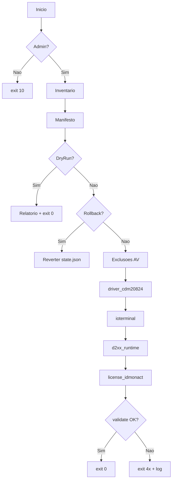

# Instalador Automatizado IOTerminal — Especificacao Tecnica

## 0. Instrucoes ao implementador

Leia esta secao antes de escrever codigo.

1. **Nao invente valores.** Caminhos, hashes, versoes de driver e nomes de arquivo vem do `manifest.json`, nunca hardcoded no script. O que nao estiver confirmado entra como `TODO` explicito (§12), nao como valor plausivel.
2. **Stack fixada:** PowerShell 5.1 (piso), script unico mais `manifest.json`. Empacotamento em `.exe` so na fase final. Nao propor outra stack.
3. **Toda operacao que altera o sistema e precedida de verificacao (`detect`) e seguida de validacao (`validate`).** Instalar sem conferir o resultado e falha de implementacao.
4. **Idempotencia e requisito.** Segunda execucao em maquina ja preparada termina em `exit 0` sem reinstalar nada.
5. **Nao executar binario de terceiro quando existir caminho deterministico equivalente.** Para driver, publicar o `.inf` com `pnputil` em vez de rodar o instalador do fabricante (§8.2).
6. **Sem acentuacao** em nomes de arquivo, pastas e codigo.

---

## 1. Objetivo

Preparar uma estacao Windows para operar o IOT Multitool: publicar o driver da interface USB, instalar a aplicacao e aplicar a licenca — em ordem deterministica, sem interacao alem do UAC, validando o resultado e produzindo log diagnosticavel.

**Nao faz parte do software:** geracao ou gestao de licencas, configuracao de rede/acesso remoto, instalacao de outras ferramentas de bancada (PCMflash, DPS, XGecu), suporte a SO nao-Windows, reparo de hardware.

---

## 2. Ambiente alvo

| Item | Valor |
|------|-------|
| SO | Windows 10 22H2 e Windows 11, x64 |
| Shell | PowerShell 5.1 (Desktop) |
| Privilegio | Administrador obrigatorio |
| Rede | Nao necessaria: os pacotes vem no kit |
| Interacao | Somente aceite do UAC |
| Dependencia externa | Nenhuma: o extrator `.rar` viaja no kit (§8.6) |

**Restricoes:**
- O Windows nao le `.rar` por linha de comando. O kit embute o extrator; se ele estiver ausente e nao houver 7-Zip/WinRAR na maquina, a execucao aborta com codigo proprio (§9) e mensagem de acao, nunca com erro cru.
- Antivirus pode bloquear extracao e copia; deve ser detectado e atribuido no diagnostico, nao contornado.
- Politicas de dominio podem impedir a publicacao de driver; devem ser detectadas e reportadas.
- Nenhuma credencial da oficina pode ser solicitada, digitada ou persistida na maquina do cliente.

---

## 3. Componentes gerenciados

Ordem obrigatoria:

| Ordem | ID | Componente | Funcao |
|:-----:|----|------------|--------|
| 1 | `driver_cdm20824` | Driver FTDI CDM 2.08.24 | Comunicacao com a interface USB (`ftdibus.inf`, `ftdiport.inf`) |
| 2 | `ioterminal` | IOT Multitool V50B | Aplicacao portatil extraida para `installDir` |
| 3 | `d2xx_runtime` | Biblioteca D2XX | Copia `ftd2xx.dll` para `installDir` e para `SysWOW64` |
| 4 | `license_idmonact` | Licenca IDMONACT | Pasta de licencas copiada para dentro de `installDir` |

Regras de ordem que nao podem ser violadas:
- `ioterminal` antes de `d2xx_runtime` e de `license_idmonact` — os dois destinos moram na pasta criada pela etapa 2.
- `driver_cdm20824` antes do primeiro uso da interface — a aplicacao so conversa com o hardware apos o driver publicado. O `pnputil` nao instala a `ftd2xx.dll`; sem a etapa 3 o IOT recusa abrir.

A condicionalidade e a ordem vem de `order` no manifesto, nunca de `if` no script.

---

## 4. Interface de linha de comando

```
installer.ps1 [-ManifestPath <caminho>]
              [-PackageDir <caminho>]
              [-LogPath <caminho>]
              [-Force]
              [-DryRun]
              [-Rollback]
              [-Reinstall]
              [-SkipAvExclusion]
```

| Parametro | Obrigatorio | Default | Semantica |
|-----------|:-----------:|---------|-----------|
| `-ManifestPath` | Nao | `.\manifest.json` | Manifesto a usar |
| `-PackageDir` | Nao | `<kit>\` + `packageRoot` | Raiz dos pacotes |
| `-LogPath` | Nao | `C:\ProgramData\OficinaBinaria\ioterminal-setup` | Diretorio de log |
| `-Force` | Nao | `false` | Reinstala componente cujo `detect` e verdadeiro |
| `-DryRun` | Nao | `false` | Diagnostica e valida o manifesto; **nao altera nada** |
| `-Rollback` | Nao | `false` | Desinstala apenas o que a ferramenta instalou |
| `-Reinstall` | Nao | `false` | Apaga a pasta do IOT e instala de novo; preserva o driver publicado |
| `-SkipAvExclusion` | Nao | `false` | Nao mexe no Defender (ambiente gerenciado) |

`-DryRun` e mutuamente exclusivo com `-Rollback`, `-Force` e `-Reinstall` (`exit 11`). `-Rollback` nao combina com `-Reinstall`. O `iniciar-kit.cmd` chama o instalador com `-Reinstall`.

---

## 5. Manifesto (`manifest.json`)

Contrato entre a ferramenta e os pacotes. Toda informacao volatil mora aqui. Esquema: `manifest.schema.json`. Detalhamento de campos: `docs/MANIFESTO.md`.

Tres tipos de componente (`kind`):

| kind | Efeito |
|------|--------|
| `driver-archive` | Extrai `.rar`, extrai o executavel interno, publica os `.inf` com `pnputil` |
| `portable-archive` | Extrai `.rar` e copia a aplicacao para `installDir` |
| `dll-copy` | Copia arquivos do pacote extraido (a `ftd2xx.dll`) para destinos declarados |
| `license-copy` | Copia a pasta de licenca para dentro de `installDir` |

Alem dos componentes, a raiz declara `bundledExtractor`: o extrator `.rar` que viaja no kit e os hashes que o autorizam a ser executado (§8.6).

Regras:
- Campo com valor `TODO` faz o manifesto ser rejeitado em execucao normal (`exit 12`), mas e **aceito em `-DryRun`**, que lista exatamente quais campos faltam.
- `detect` decide se ja esta instalado; `validate` decide se a instalacao teve exito. Listas independentes, todos os predicados verdadeiros.
- Tipos de predicado: `file` (existe, opcionalmente versao minima), `dir` (existe, opcionalmente contendo padrao, recursivo), `driver` (publicado em `pnputil /enum-drivers`, opcionalmente com versao exata), `registry`, `service`.
- O token `{installDir}` em qualquer caminho e substituido pela pasta resolvida do componente `ioterminal` (manifesto ou `state.json`). `{syswow64}` aponta para `SysWOW64` em Windows 64 bits (e para `System32` em Windows 32 bits). `{system32}` aponta para o `System32` real.

---

## 6. Fluxo de execucao

```
1.  Iniciar transcript de log
2.  Validar parametros mutuamente exclusivos       -> falha: exit 11
3.  Verificar privilegio administrativo            -> falha: exit 10
4.  Coletar inventario de ambiente (§7)            -> registrar em log
5.  Carregar e validar manifesto                   -> falha: exit 12
6.  Verificar pre-condicoes (PS, disco)            -> falha: exit 13/14
7.  Resolver raiz de pacotes e installDir
8.  Se -DryRun: relatorio de ambiente + lacunas -> exit 0
9.  Se -Rollback: executar §11.2 -> exit conforme resultado
10. Aplicar exclusoes de antivirus (§7.3)          -> falha nao fatal, registrar
11. Para cada componente, em ordem:
      a. Avaliar 'detect'
      b. Se instalado e nao -Force: SKIPPED, validar e seguir
      c. Resolver pacote e conferir SHA-256        -> falha: exit 20/21
      d. Executar a acao do 'kind'                 -> falha: exit 22/23/24/30+n
      e. Avaliar 'validate'                        -> falha: exit 40+n
      f. Gravar estado (§11.1)
      g. Se driver: conferir dispositivo PnP (§8.4)
12. Emitir sumario no log
13. Se algo pediu reinicio: exit 3010 (nao reiniciar automaticamente)
14. exit 0
```



---

## 7. Inventario e preparacao de ambiente

### 7.1 Coleta obrigatoria (sempre logada)

| Dado | Fonte |
|------|-------|
| Edicao, build e arquitetura do Windows | `Get-CimInstance Win32_OperatingSystem` |
| Versao do PowerShell | `$PSVersionTable` |
| Secure Boot | `Confirm-SecureBootUEFI` (em try/catch: lanca em BIOS legado) |
| Integridade de memoria (HVCI) | `HKLM\SYSTEM\CurrentControlSet\Control\DeviceGuard\Scenarios\HypervisorEnforcedCodeIntegrity` |
| Antivirus registrados | `root\SecurityCenter2` / `AntiVirusProduct` |
| Maquina em dominio | `Get-CimInstance Win32_ComputerSystem` -> `PartOfDomain` |
| Espaco livre em C: | `Get-PSDrive C` |
| Extrator disponivel | `ferramentas\7z.exe` do kit (preferencial) ou 7-Zip / WinRAR instalado |

### 7.2 Pre-condicoes que abortam

- Sem privilegio administrativo -> `exit 10`
- PowerShell < 5.1 -> `exit 13`
- Espaco livre abaixo de `minFreeDiskBytes` -> `exit 14`
- Pasta de pacotes ausente -> `exit 20`

### 7.3 Antivirus

- Defender: `Add-MpPreference -ExclusionPath` para a raiz de pacotes, o diretorio de trabalho, o `%TEMP%` e o `installDir`, antes de extrair.
- Antivirus de terceiros: nao manipular. Registrar o nome do produto e avisar no log.
- Falha ao criar exclusao nao aborta; e registrada e considerada na atribuicao de causa (§9, codigo 50).
- Com `-SkipAvExclusion`, a secao inteira e ignorada.

---

## 8. Instalacao e validacao

### 8.1 Execucao de processo

- Usar `System.Diagnostics.Process` com `UseShellExecute = $false` e saida redirecionada. `Start-Process -PassThru` nao e aceitavel: pode devolver `ExitCode` vazio e transformar sucesso em falha.
- Timeout por componente vem do manifesto (`timeoutSeconds`). Estouro encerra o processo e falha o componente.
- Argumentos com espaco recebem aspas; chaveados no formato `-o<caminho>` recebem aspas apenas no valor.
- Toda a saida do processo entra no log. Nunca suprimir codigo de saida.

### 8.2 Driver (decisao normativa)

O driver **nao** e instalado executando o setup do fabricante. O fluxo obrigatorio e:

```
.rar do kit -> executavel interno -> arquivos do pacote -> pnputil /add-driver <inf> /install /subdirs
```

Justificativa: o executavel presente no kit nao e assinado e declara metadados de outro fabricante, enquanto o conteudo dele e o pacote FTDI legitimo (`.cat` assinados pelo *Microsoft Windows Hardware Compatibility Publisher* e `ftdibus.sys` assinado pela FTDI). Publicar o `.inf` evita executar esse empacotador e produz resultado verificavel por `pnputil /enum-drivers`.

**O `pnputil` nao instala a biblioteca de usuario.** O pacote CDM traz `i386\ftd2xx.dll` (D2XX 3.02.07). Sem copia-la, o IOT Multitool (32 bits, protegido pelo Themida) aborta com "Cannot find 'FTD2XX.DLL'". Essa copia e o componente `d2xx_runtime` (§8.5).

**No Windows 11 o kernel 2.08.24 nao e publicado.** Campo `skipKernelBuild` (22000) e HVCI ativo: o `ftdibus.sys` de 2012 e recusado pela politica de assinatura. Um PC limpo tambem nao tem FTDI 2.12 de fabrica (a interface fica `USB_FT232RL`, Code 28). O instalador remove o 2.08.24 e publica o CDM 2.12.36.20 WHQL (`modernArchive`). A interface precisa ser desconectada e reconectada depois.

### 8.3 Validacao de driver por versao (decisao normativa)

O predicado `driver` compara **versao**, nao apenas o nome do `.inf`.

O Windows 11 recusa o kernel 2.08.24 e, em maquina limpa, nao traz FTDI 2.12 de fabrica. Em Windows 11 (ou HVCI) o componente `driver_cdm20824` considera sucesso a **ausencia** do 2.8.24.0 e a **presenca** de um `ftdibus.inf` 2.12 ou maior. Em Windows 10 antigo o fluxo continua publicando o 2.08.24 e detectando pela versao. A leitura dos blocos de `pnputil /enum-drivers` e feita por separacao de blocos e extracao de `oemN.inf` por padrao fixo, porque os rotulos da saida sao traduzidos conforme o idioma do Windows.

A mesma regra vale na reversao: apenas as versoes publicadas por este kit sao despublicadas. Remover driver FTDI de outra origem e defeito.

### 8.4 Validacao de dispositivo

`Get-PnpDevice` filtrando os `hardwareId` do manifesto. Distincao obrigatoria:

| Situacao | Interpretacao | Acao |
|----------|---------------|------|
| Driver publicado, dispositivo ausente | Interface nao conectada | `WARN`, nao erro |
| Dispositivo presente, Code 52 | Assinatura recusada | `exit 43`, citar Secure Boot/HVCI |
| Dispositivo presente, Code 43 | Falha de hardware ou driver | `exit 44` |

Hardware nao conectado nunca e reportado como falha de instalacao.

**Limite do teste em VM.** O Hyper-V nao redireciona interface USB comum para a maquina convidada, entao dentro de VM esta validacao cai sempre no primeiro caso da tabela: `WARN` de dispositivo ausente. A VM valida a publicacao do driver, a extracao da aplicacao e a licenca; conferir o dispositivo, e portanto os codigos 43 e 44, exige maquina fisica de bancada (§12.1).

### 8.5 Aplicacao portatil

- Se o `.rar` tiver uma unica pasta na raiz, ela e achatada, para nao gerar pasta dentro de pasta.
- `mainExe` pode ser marcado para abrir sempre elevado (`AppCompatFlags\Layers` = `~ RUNASADMIN`, nas views de 32 e 64 bits) e receber atalho na area de trabalho publica.

O IOT Multitool e 32 bits (`PE machine 0x14C`). A etapa seguinte (`d2xx_runtime`) copia `i386\ftd2xx.dll` para `{installDir}` e para `{syswow64}` (`SysWOW64` em Windows 64 bits). O Themida resolve `FTD2XX.DLL` via `GetSystemDirectory()`, que no processo 32 bits aponta para `SysWOW64`, nao para a pasta da aplicacao. Copiar so ao lado do `.exe` nao basta.

### 8.6 Extrator embutido (decisao normativa)

O kit distribui o extrator `.rar` em `ferramentas\`, declarado em `bundledExtractor` no manifesto, e o instalador o prefere a qualquer 7-Zip/WinRAR instalado na maquina.

Antes de executa-lo, o SHA-256 do executavel e da biblioteca de codecs e conferido contra o manifesto. Divergencia aborta com `exit 21` sem executar nada. A verificacao e obrigatoria porque:

- os binarios do 7-Zip nao sao assinados pelo autor, entao nao existe assinatura a validar;
- o extrator roda com privilegio administrativo, no mesmo processo que instala driver.

Se `bundledExtractor` for removido do manifesto, o instalador volta ao comportamento de procurar extrator instalado e falhar com `exit 22` quando nao houver. Nunca extrair com binario nao verificado quando o manifesto declarar hash.

### 8.7 Licenca

- A origem e uma **pasta** (subpastas por serial com arquivos `.bin`), copiada integralmente para `installDir\<targetSubDir>`.
- Licenca preexistente no destino e movida para `<nome>.bak-<timestamp>` antes da copia. Sobrescrever licenca sem backup e defeito.
- A validacao exige pelo menos um `.bin` presente no destino, em busca recursiva.

---

## 9. Codigos de saida

| Codigo | Significado |
|:------:|-------------|
| 0 | Sucesso |
| 1 | Erro inesperado ou rollback com falhas |
| 10 | Sem privilegio administrativo |
| 11 | Parametro invalido ou combinacao proibida |
| 12 | Manifesto invalido, ilegivel ou com campos `TODO` |
| 13 | PowerShell inferior a 5.1 |
| 14 | Espaco em disco insuficiente |
| 20 | Pacote ou pasta de pacotes ausente |
| 21 | SHA-256 divergente |
| 22 | Nenhum extrator de `.rar` disponivel |
| 23 | Falha na extracao |
| 24 | Conteudo esperado ausente no pacote extraido |
| 30 | Falha de instalacao — `driver_cdm20824` |
| 31 | Falha de instalacao — `ioterminal` |
| 32 | Falha de instalacao — `license_idmonact` |
| 33 | Falha de instalacao — `d2xx_runtime` |
| 40 | Falha de validacao — `driver_cdm20824` |
| 41 | Falha de validacao — `ioterminal` |
| 42 | Falha de validacao — `license_idmonact` |
| 43 | Dispositivo com Code 52 (assinatura) |
| 44 | Dispositivo com Code 43 (hardware/driver) |
| 45 | Falha de validacao — `d2xx_runtime` |
| 50 | Bloqueio atribuido a antivirus |
| 51 | Bloqueio atribuido a politica de dominio |
| 3010 | Sucesso, reinicio pendente |

Todo caminho de erro grava, antes de sair: codigo, componente, etapa, causa provavel e acao sugerida, em portugues. Referencia de campo: `docs/CODIGOS-SAIDA.md`.

---

## 10. Log

- Caminho: `<LogPath>\ioterminal-setup_<yyyyMMdd-HHmmss>.log`
- `Start-Transcript` no inicio, `Stop-Transcript` em `finally`.
- Linha: `[ISO-8601] [NIVEL] [COMPONENTE] mensagem`, niveis `INFO`, `WARN`, `ERROR`.
- Conteudo minimo: inventario do §7.1, versao do manifesto, SHA-256 conferido, decisao `detect` por componente, comando executado com sua saida, resultado de cada `validate`, sumario final.
- Nao registrar credenciais nem caminhos autenticados.

---

## 11. Estado, idempotencia e reversao

### 11.1 Arquivo de estado

`C:\ProgramData\OficinaBinaria\ioterminal-setup\state.json`

Registra por componente: `id`, `packageVersion`, timestamp, `installedByTool`, metodo de reversao resolvido e `installDir` usado. E a fonte de verdade do rollback e tambem o que permite executar a etapa de licenca em uma execucao separada da etapa 2.

### 11.2 Reversao

Percorre `state.json` na ordem inversa de `order`, aplicando `uninstall`:

| kind | Efeito |
|------|--------|
| `driver` | `pnputil /delete-driver <oemN.inf> /uninstall /force` apenas nas versoes do kit |
| `remove-dir` | Remove a pasta indicada (aceita `{installDir}`) |
| `remove-file` | Remove cada arquivo em `paths` (aceita `{installDir}` e `{syswow64}`) |

Componente com `installedByTool: false` e preservado e registrado como ignorado. Falha em um componente nao interrompe os demais; o codigo de saida reflete o conjunto.

### 11.3 Idempotencia

Sem `-Force`, componente cujo `detect` e verdadeiro e marcado `SKIPPED` e ainda assim tem `validate` executado. Segunda execucao em maquina integra: `exit 0`, nenhuma alteracao, log apenas com `SKIPPED` e `validate` bem-sucedidos.

---

## 12. Lacunas conhecidas

Nao implementar por suposicao.

| # | Lacuna | Como resolver |
|---|--------|---------------|
| 1 | Etapa 1 (driver) nao executada em maquina limpa com a interface conectada | Em VM limpa, conferir a publicacao por `pnputil`; a conferencia do dispositivo por `Get-PnpDevice` exige bancada fisica, porque o Hyper-V nao redireciona USB comum (§8.4) |
| 2 | `hardwareId` exato da interface usada em campo | `Get-PnpDevice` com a interface conectada; hoje o manifesto usa o prefixo generico FTDI `USB\VID_0403` |
| 3 | Confirmar se `2.08.24` e realmente obrigatoria ou se versoes 2.12.x servem | Teste em bancada: se 2.12.x servir, `driverVersion` deixa de ser igualdade e passa a versao minima |
| 4 | Nome e local exigidos pela aplicacao para a pasta de licenca | Confirmar com o IOT Multitool em uso; hoje `IDMONACT` dentro de `installDir` |
| 5 | Assinatura de codigo e empacotamento em `.exe` | Reaproveitar o procedimento do projeto PCMFlash |

Itens 1 e 2 sao pre-requisito para declarar a Fase 4 concluida.

**Resolvidas em 2026-09-16:** dependencia de 7-Zip instalado (extrator embutido e verificado, §8.6) e circulacao do empacotador `CDM20824_Setup.exe` nao assinado (removido do kit; o fluxo nunca o executava).

**Resolvida em 2026-10-01:** Themida em PC limpo recusava abrir o IOT com "Cannot find 'FTD2XX.DLL'". Causa: `pnputil` nao instala a biblioteca D2XX. Correcao: componente `d2xx_runtime` copia `i386\ftd2xx.dll` para `{installDir}` e `{syswow64}` (§8.5).

---

## 13. Criterios de aceitacao

Cada item e um teste executavel. Status apurado em Windows 11 Pro build 26200.

| # | Teste | Resultado esperado | Status |
|---|-------|--------------------|--------|
| A1 | Maquina limpa, interface conectada, execucao unica | `exit 0`; aplicacao comunica com a interface | Pendente; exige bancada fisica (§8.4, §12.1) |
| A2 | Repetir A1 sem `-Force` | `exit 0`, nenhuma acao, log so com `SKIPPED` | **PASS** (etapas 2 e 3) |
| A3 | Corromper 1 byte de um pacote | `exit 21` antes de qualquer alteracao | Pendente |
| A4 | Manifesto com campo `TODO` em execucao normal | `exit 12` nomeando o campo | Pendente |
| A5 | Idem em `-DryRun` | `exit 0` com relatorio das lacunas | **PASS** (relatorio emitido; sem `TODO` no manifesto atual) |
| A6 | Executar sem elevacao | `exit 10`, nenhuma alteracao | **PASS** |
| A7 | Instalacao completa sem a interface conectada | `exit 0` com `WARN` de dispositivo ausente | Pendente |
| A8 | Driver do kit em maquina que ja tem FTDI 2.12.x de fabrica | Driver do kit e publicado; nao ha `SKIPPED` indevido | **PASS** em `detect` (publicacao pendente com §12.1) |
| A9 | `-Rollback` apos instalacao | Remove o que a ferramenta instalou, preserva o resto | **PASS** (etapas 2 e 3) |
| A10 | Instalacao parcial preexistente (so etapa 2) | Completa a licenca, `SKIPPED` na etapa 2, `exit 0` | **PASS** |
| A11 | Licenca preexistente no destino | Backup `.bak-<timestamp>` criado antes da copia | Pendente |
| A12 | Maquina sem 7-Zip nem WinRAR | Instala normalmente com o extrator do kit | Coberto por construcao; confirmar na VM limpa |
| A13 | Kit montado por `preparar-kit.ps1`, executado de outra pasta | Encontra manifesto e pacotes sozinho; `exit 0` em `-DryRun` | **PASS** |
| A14 | Grep no log de qualquer execucao | Nenhuma credencial ou caminho autenticado | **PASS** |
| A15 | Alterar 1 byte do extrator embutido | `exit 21` antes de executar o extrator | **PASS** |
| A16 | Kit gerado com extrator embutido, maquina com 7-Zip instalado | Usa o extrator do kit, nao o instalado | **PASS** |
| A17 | PC limpo, IOT abre sem "Cannot find FTD2XX.DLL" | `ftd2xx.dll` em `{installDir}` e em `SysWOW64`; Themida nao reclama | Pendente (reteste com o kit v0.3.4) |

---

## 14. Fases

| Fase | Escopo | Saida | Status |
|------|--------|-------|--------|
| 1 | Levantamento dos pacotes reais (tipo, hashes, conteudo, predicados) | `manifest.json` preenchido | Concluida |
| 2 | Fluxo feliz: extracao, instalacao ordenada, `validate` | v0.1 | Concluida |
| 3 | Erros, codigos de saida, log, `state.json`, idempotencia, rollback | v0.2 | Concluida |
| 4 | Execucao da matriz A1–A16 e correcoes | Matriz preenchida | Parcial (§13); A1 depende de bancada fisica (§12.1) |
| 5 | `.exe` assinado, procedimento de atualizacao | v1.0 | Pendente |

---

## 15. Documentacao de implementacao

Esta especificacao define **requisitos**. A documentacao de implementacao vive no repositorio:

| Documento | Conteudo |
|-----------|----------|
| [README.md](README.md) | Visao geral, inicio rapido e decisoes tecnicas |
| [docs/OPERACAO.md](docs/OPERACAO.md) | Parametros, cenarios, log e rollback |
| [docs/MANIFESTO.md](docs/MANIFESTO.md) | Contrato do `manifest.json` |
| [docs/CODIGOS-SAIDA.md](docs/CODIGOS-SAIDA.md) | Codigos de saida e diagnostico |
| [docs/CHANGELOG.md](docs/CHANGELOG.md) | Historico de alteracoes |
| [PASSO-A-PASSO.txt](PASSO-A-PASSO.txt) | Instrucoes para o cliente final |

**Regra:** toda alteracao de codigo ou de configuracao atualiza a documentacao correspondente e o `CHANGELOG.md`.
